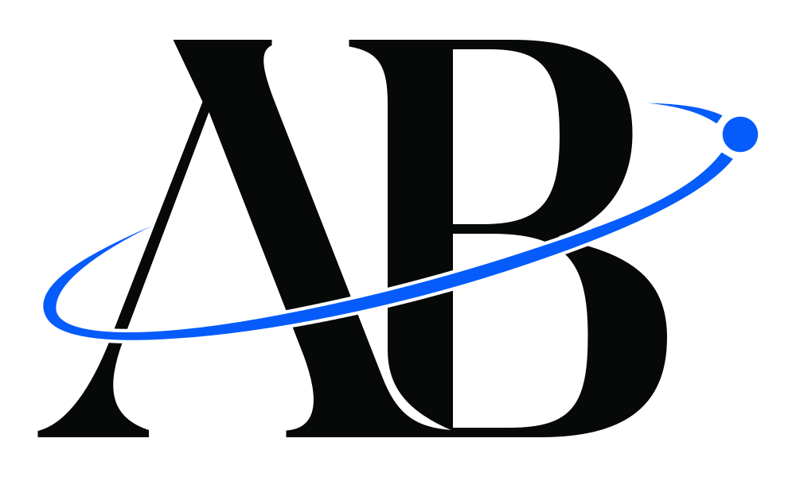
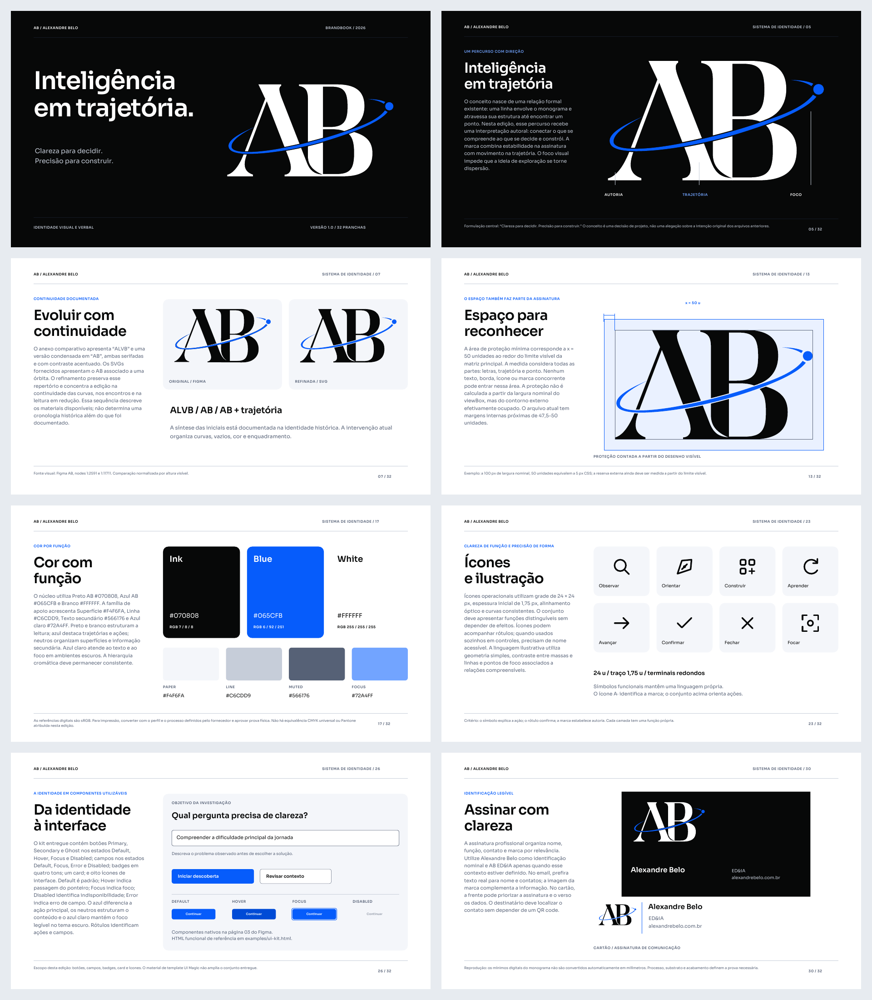

# AB — Sistema de identidade

<picture>
  <source media="(prefers-color-scheme: dark)" srcset="assets/logo/ab-reverse.svg">
  
</picture>

**Inteligência em trajetória.**

Sistema de identidade de Alexandre Belo / AB ED&IA: refinamento do monograma,
família de assinaturas, símbolo reduzido A·, tokens de interface e brandbook
completo. **O posicionamento e a interpretação da marca nesta edição são
propostas autorais.** A fundamentação distingue a evidência dos materiais
originais das novas decisões de design.

**[Abrir o novo Figma editável](https://www.figma.com/design/VTETqqBjYKD3bNACqqwS0A)**
· **[Baixar o brandbook PDF](brandbook/AB-Brandbook.pdf)**
· **[Abrir o brandbook HTML](brandbook/index.html)**
· **[Ler o manual completo](brandbook/brandbook.md)**

## Comece pelo arquivo certo

| Necessidade | Arquivo |
|---|---|
| Logo principal em fundo claro | [ab-primary.svg](assets/logo/ab-primary.svg) |
| Logo principal em fundo escuro | [ab-reverse.svg](assets/logo/ab-reverse.svg) |
| Monocromia preta | [ab-black.svg](assets/logo/ab-black.svg) |
| Monocromia branca | [ab-white.svg](assets/logo/ab-white.svg) |
| Aplicação compacta | [ab-compact.svg](assets/logo/ab-compact.svg) |
| Aplicação compacta em fundo escuro | [ab-compact-reverse.svg](assets/logo/ab-compact-reverse.svg) |
| Assinatura com nome | [ab-alexandre-belo.svg](assets/logo/ab-alexandre-belo.svg) |
| Assinatura com nome em fundo escuro | [ab-alexandre-belo-reverse.svg](assets/logo/ab-alexandre-belo-reverse.svg) |
| Assinatura com nome e identificador ED&IA | [ab-edia.svg](assets/logo/ab-edia.svg) |
| Assinatura ED&IA em fundo escuro | [ab-edia-reverse.svg](assets/logo/ab-edia-reverse.svg) |

Os **10 SVGs da família de logo** usam vetores autônomos. O lettering das
assinaturas está convertido em contornos; não é necessário instalar a fonte
para exibi-los. A sigla ED&IA permanece literal, conforme a identificação
fornecida.

### Escala responsiva

| Largura CSS de aplicação | Família | Arquivo de referência |
|---|---|---|
| A partir de 96 px | Monograma principal | [ab-primary.svg](assets/logo/ab-primary.svg) |
| 64–95 px | Monograma compacto | [ab-compact.svg](assets/logo/ab-compact.svg) |
| 16–63 px | Símbolo micro A· | [ab-micro-transparent.svg](assets/icons/ab-micro-transparent.svg) |

O símbolo micro A· combina o A recomposto e o ponto de foco. Ele é uma
derivação própria da identidade; sua leitura não contém o monograma AB inteiro.
As quatro variantes estão em `assets/icons/`: [campo azul](assets/icons/ab-micro.svg),
[transparente](assets/icons/ab-micro-transparent.svg),
[reversa](assets/icons/ab-micro-reverse.svg) e
[monocromática](assets/icons/ab-micro-mono.svg).

As regras de fundos, proteção e escolha da família estão no
[brandbook](brandbook/brandbook.md) e na
[documentação do sistema de ícones](docs/icon-system.md). O
[mostruário de interface](examples/ui-kit.html#marca) permite explorar a troca
de arquivos pelas faixas de tamanho.

## Conteúdo da edição 1.0.0

| Entrega | Conteúdo |
|---|---|
| Brandbook | **32 pranchas** em SVG, documento PDF, HTML navegável e manual em Markdown. |
| Família da logo | **10 SVGs**: principal, reversa, monocromias, compactas e assinaturas. |
| Símbolo micro | A· em quatro variantes, acompanhado de ícones PNG/ICO para aplicações digitais. |
| Ícones de interface | **8 SVGs** sobre grade de 24 unidades: observar, direção, construir, aprender, seta, confirmação, fechar e foco. |
| Elementos de apoio | Trajetória e ponto de foco extraídos do sistema da marca. |
| Tipografia | Sora variável em TTF e WOFF local, com SIL Open Font License 1.1 incluída. |
| Tokens | Especificação JSON, variáveis CSS e formato de intercâmbio de tokens. |
| Aplicações | **8 peças vetoriais**: desktop, mobile, apresentação, social, avatar, cartão frente/verso e assinatura de comunicação. |
| Exemplos | UI kit local com temas e estados; assinatura de e-mail com PNG; entrada da logo em 600 ms com alternativa estática. |
| Produção | Builders de assets, tokens, brandbook e aplicações; preparação das páginas nativas no Figma; validador sem dependências externas. |
| Proveniência | Arquivo histórico verificável e preservação dos **8 caminhos legados** da raiz. |

### Mapa do brandbook

| Pranchas | Assuntos |
|---|---|
| 01–05 | Capa, navegação, posicionamento proposto, princípios e conceito. |
| 06–09 | Anatomia, evolução visual, ajustes no negativo e construção medida. |
| 10–16 | Variantes, assinaturas, monocromia, proteção, escala, fundos e usos incorretos. |
| 17–20 | Paleta, contraste, Sora, hierarquia e espaçamento tipográfico. |
| 21–25 | Grid, elementos gráficos, ícones, ilustração, movimento e voz. |
| 26–30 | UI kit, aplicação digital, editorial, social, assinatura e cartão. |
| 31–32 | Ativos, manutenção, fontes e créditos. |

[](brandbook/AB-Brandbook.pdf)

### Aplicações prontas para edição

| Peça | Dimensões | Arquivo |
|---|---|---|
| Presença digital desktop | 1440 × 960 px | [digital-desktop.svg](assets/applications/digital-desktop.svg) |
| Presença digital mobile | 390 × 844 px | [digital-mobile.svg](assets/applications/digital-mobile.svg) |
| Capa de apresentação | 1920 × 1080 px | [presentation-cover.svg](assets/applications/presentation-cover.svg) |
| Publicação social | 1080 × 1080 px | [social-square.svg](assets/applications/social-square.svg) |
| Avatar A· | 512 × 512 px | [avatar.svg](assets/applications/avatar.svg) |
| Cartão — frente | 90 × 50 mm | [business-card-front.svg](assets/applications/business-card-front.svg) |
| Cartão — verso | 90 × 50 mm | [business-card-back.svg](assets/applications/business-card-back.svg) |
| Assinatura de comunicação | 800 × 200 px | [communication-signature.svg](assets/applications/communication-signature.svg) |

Os textos de comunicação incluem Sora WOFF nos próprios SVGs; as assinaturas
da marca continuam em contornos. O arquivo `assets/applications/scene.json`
alimenta as oito composições nativas da página **04 — Aplicações** no Figma.
Os layouts digitais são peças editáveis de identidade; a migração do site é
documentada como trabalho próprio do consumidor. As orientações para cartão,
sangria e uso estão em [docs/applications.md](docs/applications.md).

## Estrutura do repositório

| Caminho | Uso |
|---|---|
| `assets/logo/` | Matrizes ópticas e variantes da assinatura. |
| `assets/icons/` | Símbolos micro, favicons, ícones de aplicação e `ui/` com os oito ícones funcionais. |
| `assets/graphics/` | Elementos gráficos de apoio. |
| `assets/applications/` | Oito peças SVG e `scene.json` para a composição nativa no Figma. |
| `assets/png/` | Derivados raster transparentes dos monogramas. |
| `assets/fonts/` | Sora local e sua licença original. |
| `tokens/` | `brand.json`, `brand.css` e `brand.tokens.json`. |
| `brandbook/` | PDF, HTML, Markdown, `copy.json`, `scene.json`, 32 páginas SVG e referências de origem. |
| `docs/` | Fundamentação, créditos, contraste, ícones, migração, manutenção e registros de revisão/Figma. |
| `examples/` | UI kit, assinatura de e-mail e movimento de entrada da logo com redução de movimento. |
| `archive/2025/` | Oito SVGs de origem, com manifesto do commit de 2025. |
| `scripts/` | Construção de derivados, tokens e brandbook; fontes para Figma; validação de conteúdo e integridade. |
| `requirements-build.txt` | Dependências Python de produção nas versões observadas. |
| `.github/workflows/validate.yml` | Verificação em pull requests, atualizações de `main` e execução manual. |
| `build/` | Intermediários locais de produção, ignorados pelo Git. |

O contrato de distribuição e o esquema do manifesto são descritos em
[docs/repository.md](docs/repository.md).

## Abrir e explorar localmente

O PDF pode ser aberto diretamente. Para o HTML, mantenha a estrutura de pastas
do repositório; o manual e os exemplos utilizam os assets e a fonte distribuídos
no pacote.

- [Manual HTML](brandbook/index.html): navegação e busca nas pranchas.
- [UI kit](examples/ui-kit.html): botões, campos, badges, cards, tema claro/escuro
  e seleção da logo por escala.
- [Assinatura de e-mail](examples/email-signature.html): aplicação com nome e
  site, acompanhada de instruções para instalar a imagem no cliente de e-mail.
- [Movimento da logo](examples/logo-motion.html): entrada única de **600 ms**,
  repetição por botão e controle de assinatura estática. A preferência
  `prefers-reduced-motion: reduce` mantém a logo completa sem animação.

Para servir os arquivos localmente, a partir da raiz:

```sh
python3 -m http.server 8000 --bind 127.0.0.1
```

Abra `http://127.0.0.1:8000/brandbook/index.html` ou
`http://127.0.0.1:8000/examples/ui-kit.html`. As interações dos exemplos não
enviam formulários nem integram serviços externos.

## Validar os arquivos

O validador precisa somente da biblioteca padrão do Python:

```sh
python3 scripts/validate.py
```

Ele verifica o contrato dos SVGs canônicos, os JSONs de tokens, a presença dos
arquivos obrigatórios, a integridade do acervo de 2025 e os caminhos, tamanhos
e hashes SHA256 de `asset-manifest.json`.

Depois de uma mudança intencional e da revisão dos derivados:

```sh
python3 scripts/validate.py --write-manifest
```

A validação não mede qualidade óptica nem substitui a revisão visual. Os
exemplos HTML receberam conferência estática de referências, associações
acessíveis e sintaxe dos handlers. **Não foi concluída uma validação visual ou
de ponta a ponta desses HTMLs em navegador nesta execução.** O registro está em
[docs/repository.md](docs/repository.md#conferência-dos-exemplos-html).

## Reconstruir os derivados

Os builders usam os arquivos locais do repositório. O build dos assets parte
das matrizes ópticas `ab-primary.svg` e `ab-compact.svg`; essas duas matrizes
são desenhos autorais editáveis e não são reconstruídas a partir de uma fonte.

Use Python 3.11 ou superior para a produção. O ambiente observado nesta edição
utilizou Python **3.12.14**, Pillow **12.3.0**, fonttools **4.61.1**, ReportLab
**4.4.9** e charset-normalizer **3.5.2**. As versões dos pacotes Python estão
registradas em
[requirements-build.txt](requirements-build.txt). Elas descrevem o ambiente
observado; a instalação em um ambiente limpo de outro sistema não foi certificada
nesta entrega.

Crie um ambiente virtual e instale as dependências de produção:

```sh
python3 -m venv .venv
```

```sh
.venv/bin/python -m pip install -r requirements-build.txt
```

Execute os builders na sequência:

```sh
.venv/bin/python scripts/build_assets.py
.venv/bin/python scripts/build_tokens.py
.venv/bin/python scripts/build_brandbook.py
.venv/bin/python scripts/build_applications.py
```

`build_assets.py` gera variantes, assinaturas em contornos, WOFF e gráficos.
`build_tokens.py` gera CSS e os tokens de intercâmbio a partir de `brand.json`.
`build_brandbook.py` usa `copy.json`, a fonte local e os assets para gerar a
cena editorial, as pranchas SVG, o HTML e o PDF. Os arquivos intermediários
das instâncias de Sora ficam em `build/fonts/`.
`build_applications.py` gera as oito peças SVG, sua cena estruturada e
`examples/logo-motion.html` a partir dos assets e da composição local.

Para regenerar também os PNGs dos monogramas, disponibilize o executável
Inkscape no `PATH` e use:

```sh
.venv/bin/python scripts/build_assets.py --png
```

A versão observada de Inkscape foi **1.2.2**. Ele é uma dependência de sistema
apenas dessa exportação; não faz parte de `requirements-build.txt`. A criação
do PDF usa ReportLab, sem browser. Depois de gerar e rever todos os resultados,
atualize o manifesto:

```sh
.venv/bin/python scripts/validate.py --write-manifest
```

### Preparar a reconstrução no Figma

As páginas nativas utilizam os SVGs, tokens e templates JavaScript do
repositório. A preparação local dos builders de assinaturas e componentes é:

```sh
python3 scripts/prepare_figma_library.py
```

O fluxo de foundations, execução, registro dos IDs retornados e conferência
está em [docs/figma-library.md](docs/figma-library.md). O preparador utiliza o
mapa de `docs/figma-library.json`; esse mapa pertence ao arquivo Figma indicado
e deve ser atualizado ao reconstruir a biblioteca em outro arquivo.

Para as 32 pranchas, prepare **oito lotes de quatro páginas**:

```sh
python3 scripts/prepare_figma_book.py --pages 1:4
python3 scripts/prepare_figma_book.py --pages 5:8
python3 scripts/prepare_figma_book.py --pages 9:12
python3 scripts/prepare_figma_book.py --pages 13:16
python3 scripts/prepare_figma_book.py --pages 17:20
python3 scripts/prepare_figma_book.py --pages 21:24
python3 scripts/prepare_figma_book.py --pages 25:28
python3 scripts/prepare_figma_book.py --pages 29:32
```

Os arquivos resultantes ficam em `build/figma-book-01-04.js` até
`build/figma-book-29-32.js`. Cada lote é executado separadamente no Figma após
a preparação da biblioteca. O preparador rejeita código com mais de 50.000
caracteres; os arquivos locais não atualizam o Figma por conta própria.

As oito aplicações usam o mesmo preparador, com a cena e a página de destino
próprias, em dois lotes de quatro. Os comandos completos estão em
[docs/applications.md](docs/applications.md#reconstrução).

## Compatibilidade e migração

Estes caminhos históricos continuam preservados byte a byte:

`apple-touch-icon.svg`, `faviconw.svg`, `favivonb.svg`, `logo.svg`,
`logo_dark.svg`, `logoazul.svg`, `logob.svg` e `logoblack.svg`.

Eles correspondem ao commit
[`a162752f7c5a8237352b3eac228d52e50484eddf`](https://github.com/oalexandrebelo/logosvg/commit/a162752f7c5a8237352b3eac228d52e50484eddf).
A grafia de `favivonb.svg` também é preservada. Novas integrações usam os
caminhos canônicos em `assets/`.

O mapa de migração registra os consumidores reais de `portfolio-AB`, incluindo
header, footer, metadados e o logo inline da área de estudos. Esta entrega de
identidade não aplica alterações ao site. Veja o procedimento completo e a
reversão em [docs/migration.md](docs/migration.md).

## Fontes, créditos e direitos

O refinamento considera os SVGs AB fornecidos, o Figma original e as referências
visuais WOOW e da ilustração tipográfica indicada. O método de manipulação
vetorial foi orientado pela
[`logo-designer-skill`](https://github.com/neonwatty/logo-designer-skill).
O sistema resultante, seu posicionamento e sua analogia visual são apresentados
como proposta autoral para AB.

As fontes, a função de cada referência e os limites de interpretação estão em
[docs/design-rationale.md](docs/design-rationale.md). A documentação do símbolo
micro está em [docs/icon-system.md](docs/icon-system.md).

**Não há licença pública concedida para a marca, as peças autorais ou o código
gerado deste repositório.** A fonte Sora mantém sua licença própria, a
[SIL Open Font License 1.1](assets/fonts/OFL.txt). As condições estão separadas
em [LICENSE.md](LICENSE.md).
